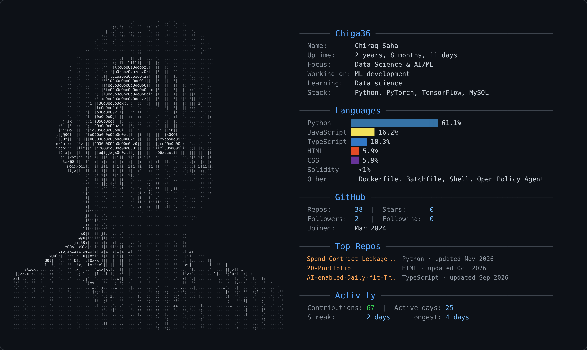
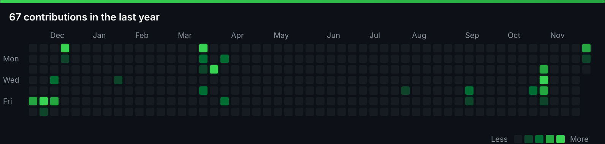

  

 

  

  Hi 👋, I'm <strong>Chirag Saha</strong>, a Data Science and AI enthusiast. 
  Most of what lives here is ML, NLP and document-AI work, written mainly in Python.

 

  

  RAG pipelines and document-AI microservices · AI agents for finance and shopping 
  Image captioning, story generation and character–background blending 
  Legal-document management and contract spend-leakage analysis

  
  
  
  
  
  
  

 

  

  🔭 Working on <strong>ML development</strong> 
  🌱 Learning <strong>data science</strong> 
  👯 Open to collaborating on <strong>legal-tech projects</strong>

  
  
  

 

  

  

  &nbsp;
  &nbsp;
  

